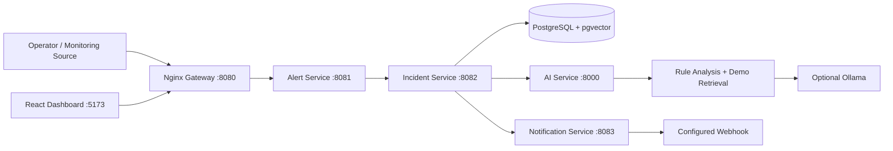

<div align="center">

# 🛡️ SentinelOps 2.0

### AI-Assisted Production Incident Intelligence

**Turn production signals into structured investigations and actionable engineering context.**

<p>
  
  
  
  
  
  
</p>

[Overview](#-overview) · [Architecture](#-architecture) · [Quick Start](#-quick-start) · [API](#-api-reference) · [Roadmap](#-roadmap)

</div>

---

## 📌 Overview

**SentinelOps 2.0** is a portfolio-grade incident intelligence platform that demonstrates how production alerts can be ingested, persisted, enriched with AI-assisted analysis, and presented through an operations dashboard.

The project is implemented as a small service-oriented system:

- **Java 21 and Spring Boot** services handle alert ingestion, incident lifecycle management, and notifications.
- **Python and FastAPI** provide deterministic log-signature analysis, demonstration retrieval, and optional local LLM enrichment.
- **PostgreSQL with pgvector** stores incident data and provides the vector extension foundation.
- **React and TypeScript** power the incident dashboard.
- **Docker Compose** starts the local application stack.

> **Project status:** This repository is a runnable MVP foundation, not a production-certified SRE platform. AI output is advisory. The application does not execute infrastructure remediation.

## ✨ What It Does

| Capability | Current implementation |
|---|---|
| Alert ingestion | Validates alert payloads and forwards them to the incident service |
| Incident lifecycle | Persists incidents and supports status updates |
| AI-assisted analysis | Matches known log signatures and returns investigation guidance |
| Context retrieval | Retrieves similar examples from a small in-code demonstration corpus |
| Optional LLM | Can enrich the initial analysis through Ollama |
| Notifications | Can forward incident notifications to a configured webhook |
| Operations dashboard | Lists incidents, filters the feed, displays analysis, and updates status |
| Local orchestration | Docker Compose configuration for the application services |

## 🏗️ Architecture



### Alert-to-investigation flow

1. A monitoring source or operator submits an alert to `POST /api/v1/alerts`.
2. The alert service validates the request and forwards it to the incident service.
3. The incident service persists the incident in PostgreSQL.
4. The incident service requests analysis from the FastAPI service.
5. The AI service evaluates known log signatures, retrieves matching examples, and optionally calls Ollama.
6. The incident service stores the returned analysis and attempts notification dispatch.
7. The dashboard retrieves incidents through the Nginx gateway and displays their status and investigation details.

### Service responsibilities

| Component | Port | Responsibility |
|---|---:|---|
| Nginx gateway | `8080` | Local API edge and route forwarding |
| Alert service | `8081` | Alert validation and forwarding |
| Incident service | `8082` | Incident persistence, lifecycle, and AI integration |
| Notification service | `8083` | Optional webhook dispatch |
| AI service | `8000` | Log analysis, demonstration retrieval, optional Ollama |
| React frontend | `5173` | Incident dashboard |
| PostgreSQL | `5432` | Incident storage and pgvector-enabled schema |

## 🧰 Technology Stack

| Area | Technology |
|---|---|
| Backend services | Java 21, Spring Boot 3.4 |
| AI API | Python, FastAPI, Pydantic |
| Optional LLM runtime | Ollama |
| Relational database | PostgreSQL 16 |
| Vector extension | pgvector |
| Frontend | React, TypeScript, Vite |
| API edge | Nginx |
| Observability profile | Prometheus, Grafana |
| Containers | Docker, Docker Compose |
| Testing | Spring Boot Test, pytest, smoke-test script |

## 🚀 Quick Start

### Prerequisites

- Docker Desktop or Docker Engine
- Docker Compose plugin
- Git

Docker Compose is the recommended way to run the complete local stack. Java 21, Maven, Python, and Node.js are only needed when running services directly on your machine.

### 1. Clone the repository

```bash
git clone <YOUR_REPOSITORY_URL>
cd SentinelOps-2.0
```

Replace `<YOUR_REPOSITORY_URL>` with the URL of your GitHub repository.

### 2. Create the environment file

```bash
cp .env.example .env
```

The example file contains local development defaults. Change credentials before exposing any service beyond your own machine.

### 3. Build and start the stack

```bash
docker compose up --build
```

The first build may take several minutes while Docker downloads base images and dependencies.

### 4. Open the application

| Interface | Address |
|---|---|
| Dashboard | [http://localhost:5173](http://localhost:5173) |
| API gateway | [http://localhost:8080](http://localhost:8080) |
| AI service health | [http://localhost:8000/health](http://localhost:8000/health) |
| AI API documentation | [http://localhost:8000/docs](http://localhost:8000/docs) |

The Java services also expose Spring Boot Actuator health endpoints on their respective service ports.

## 🧪 Try It: Submit a Demo Alert

With the stack running, submit a sample payment-service alert:

```bash
curl -X POST "http://localhost:8080/api/v1/alerts" \
  -H "Content-Type: application/json" \
  -d '{
    "serviceName": "payment-service",
    "environment": "production",
    "severity": "HIGH",
    "message": "Payment requests failing",
    "logs": "HikariPool-1 - Connection is not available, request timed out after 30000ms"
  }'
```

Then open the dashboard at [http://localhost:5173](http://localhost:5173) to inspect the incident and its analysis.

### Example analysis behavior

For the sample log above, the deterministic analyzer is expected to match the database connection-pool signature and suggest checks such as:

- Inspect active and idle database connections.
- Look for connection leaks and long-running transactions.
- Review pool sizing and timeout configuration against database capacity.

These are diagnostic suggestions, not proof of root cause.

## 🔌 API Reference

The following routes are exposed through the local gateway unless otherwise noted.

| Method | Endpoint | Description |
|---|---|---|
| `POST` | `/api/v1/alerts` | Submit an alert and create an incident |
| `GET` | `/api/v1/incidents` | List incidents |
| `GET` | `/api/v1/incidents/{id}` | Retrieve an incident |
| `PATCH` | `/api/v1/incidents/{id}/status` | Update incident status |
| `POST` | `/api/v1/incidents/{id}/investigate` | Re-run AI analysis |
| `GET` | `http://localhost:8000/health` | AI service health |
| `POST` | `http://localhost:8000/analyze` | Run AI analysis directly |

Supported incident statuses:

`OPEN` · `INVESTIGATING` · `MITIGATED` · `RESOLVED`

See [`docs/API.md`](docs/API.md) for request examples and service-level details.

## 🧠 AI Analysis and Retrieval

The current AI workflow combines three techniques:

1. **Deterministic signature matching** — checks logs for known patterns such as connection-pool exhaustion, memory exhaustion, connection failures, timeouts, null-pointer exceptions, and HTTP 500 errors.
2. **Demonstration retrieval** — compares the incoming log text with a small in-code sample corpus using lexical overlap.
3. **Optional Ollama enrichment** — sends the initial hypothesis and supporting context to a locally hosted Ollama model when enabled.

By default, `LLM_PROVIDER=none`, so the application does not require an LLM download to run.

**Important distinction:** Although the database schema includes a `vector(384)` column, the current retrieval function does not yet generate embeddings or execute pgvector similarity queries. Persistent semantic retrieval is a documented extension. See [`docs/RAG.md`](docs/RAG.md).

## 🖥️ Local Development

Use Docker Compose for PostgreSQL:

```bash
docker compose up postgres -d
```

### AI service

```bash
cd ai-service
python -m venv .venv
source .venv/bin/activate
pip install -r requirements.txt
uvicorn app.main:app --reload
```

### Java services

Run each service in a separate terminal:

```bash
cd services/alert-service
mvn spring-boot:run
```

```bash
cd services/incident-service
mvn spring-boot:run
```

```bash
cd services/notification-service
mvn spring-boot:run
```

### Frontend

```bash
cd frontend
npm install
npm run dev
```

When running services outside Docker, make sure their environment variables point to the correct hostnames and ports. Docker service names such as `postgres` and `ai-service` resolve only inside the Compose network.

## 📈 Optional Observability Profile

The Compose file includes an optional Prometheus and Grafana profile:

```bash
docker compose --profile observability up --build
```

- Prometheus: [http://localhost:9090](http://localhost:9090)
- Grafana: [http://localhost:3001](http://localhost:3001)

The profile provides the observability containers and Prometheus configuration. Confirm that application metrics are exposed and scraped as expected before relying on dashboards.

## 🧪 Validation

A basic smoke-test script is included:

```bash
chmod +x scripts/smoke-test.sh
./scripts/smoke-test.sh
```

It checks AI health, submits a sample alert, and retrieves the incident list. Run it after the containers are healthy.

Python AI tests:

```bash
cd ai-service
pytest
```

Java service tests:

```bash
cd services/incident-service
mvn test
```

## 📂 Repository Structure

```text
SentinelOps-2.0/
├── .github/
│   └── workflows/
│       └── ci.yml
├── ai-service/
│   ├── app/
│   │   ├── main.py
│   │   └── rag.py
│   ├── tests/
│   ├── Dockerfile
│   └── requirements.txt
├── docs/
│   ├── API.md
│   ├── ARCHITECTURE.md
│   ├── AWS-DEPLOYMENT.md
│   ├── RAG.md
│   ├── ROADMAP-45-DAYS.md
│   └── SECURITY.md
├── frontend/
│   └── src/
├── infra/
│   ├── nginx/
│   ├── postgres/
│   └── prometheus/
├── scripts/
│   └── smoke-test.sh
├── services/
│   ├── alert-service/
│   ├── incident-service/
│   └── notification-service/
├── .env.example
├── docker-compose.yml
└── README.md
```

## 🔐 Security and Operational Boundaries

This repository is intended for local development and portfolio demonstration. Before production use, address at least the following:

- Add authentication and authorization for operator and service APIs.
- Restrict CORS and network exposure; do not expose internal service ports publicly.
- Replace example credentials and use a managed secrets store.
- Add request-size limits, rate limiting, timeouts, and bounded retries.
- Redact credentials, tokens, personal information, and sensitive payloads from logs.
- Validate and constrain LLM output before displaying or using it.
- Treat incoming logs and retrieved incident text as untrusted input.
- Add audit history, backups, restore tests, and operational alerting.
- Keep AI read-only. Any future remediation capability must require explicit approval, scoped permissions, auditability, and rollback.

See [`docs/SECURITY.md`](docs/SECURITY.md) for the security checklist.

## ☁️ Deployment Direction

The AWS deployment guide documents a possible path using ECS Fargate, ECR, an Application Load Balancer, RDS PostgreSQL, CloudWatch, and Secrets Manager.

It is a deployment guide, not an included infrastructure-as-code implementation. Review service health checks, networking, secrets, database compatibility, costs, and scaling before deployment.

See [`docs/AWS-DEPLOYMENT.md`](docs/AWS-DEPLOYMENT.md).

## 🗺️ Roadmap

The repository includes a 45-day implementation roadmap. Planned extensions include:

- Kafka-based event processing with transactional outbox and idempotent consumers.
- OpenTelemetry ingestion and OpenSearch indexing.
- Embedding generation and persistent pgvector retrieval.
- Structured LLM outputs, evaluation, and safety guardrails.
- Alert correlation, anomaly detection, and service-level objective analytics.
- Strong authentication, RBAC, and tenant isolation.
- Production deployment automation and infrastructure hardening.

These are roadmap items unless explicitly identified as implemented in the current code.

## 🎯 Engineering Concepts Demonstrated

- Service-oriented backend design with Spring Boot.
- REST API contracts and request validation.
- Incident lifecycle and relational persistence.
- Python AI service integration.
- Rule-based log analysis and retrieval-augmented workflows.
- Optional local LLM integration.
- React and TypeScript dashboard development.
- Docker Compose orchestration.
- Operational documentation and deployment planning.

## 👨‍💻 Author

**Lakshya Kansal**  
Full-Stack Developer · MCA Student · Software Development Enthusiast

Interested in distributed systems, backend engineering, AI-assisted developer tools, and reliable software architecture.

---

<div align="center">

**🛡️ SentinelOps 2.0 — Clarity for the moments production gets complicated.**

If this project is useful or interesting, consider giving it a ⭐ on GitHub.

</div>
