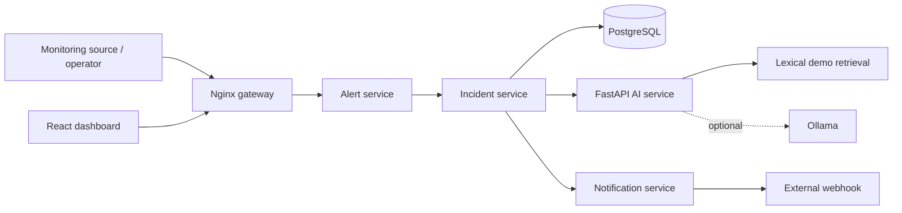

# Architecture

## System context

SentinelOps 2.0 is a local, service-oriented incident-intelligence MVP. It separates alert intake, incident lifecycle management, notification dispatch, AI analysis, and the operator dashboard into independently runnable components.

## Component responsibilities

| Component | Responsibility | Current communication |
|---|---|---|
| Gateway | Exposes selected API routes to local clients | Nginx reverse proxy |
| Alert service | Validates incoming alert requests and forwards them | Synchronous HTTP |
| Incident service | Persists incidents, manages status, requests AI analysis | Spring Data JPA and HTTP |
| AI service | Applies log-signature rules, retrieves demonstration context, optionally calls an LLM | FastAPI |
| Notification service | Dispatches a notification to an optional configured webhook | HTTP |
| Frontend | Displays incident list and selected incident details | REST through gateway |
| PostgreSQL | Stores incident data and historical-incident schema | JDBC / SQL |

## Request lifecycle

1. A client submits an alert to `POST /api/v1/alerts`.
2. Alert Service validates the payload and forwards it to Incident Service.
3. Incident Service creates an incident record.
4. Incident Service calls the AI service with the service name and raw logs.
5. AI Service returns a root-cause hypothesis, recommendations, confidence label, evidence, and retrieval metadata.
6. Incident Service persists the returned analysis.
7. Incident Service attempts to send a notification. Webhook delivery is optional and failure does not undo incident creation.
8. The dashboard reads the incident collection and detail fields from the gateway.

## Data and consistency

The current implementation uses synchronous HTTP between services and a shared PostgreSQL database for the local MVP. Incident creation and downstream AI/notification calls are not an event-driven transaction.

The next reliability milestone should introduce an outbox pattern, durable message broker, idempotent consumers, bounded retries, and dead-letter handling. In a larger deployment, define explicit data ownership and consider database-per-service or separately owned schemas.

## AI boundaries

The current retrieval function uses lexical overlap against a small in-code demonstration corpus. The schema includes a pgvector column, but embeddings are not currently generated or queried. Ollama is optional and disabled by default.

Incoming logs and retrieved text must be treated as untrusted data. AI output is advisory; the application does not execute shell commands, modify infrastructure, or perform automated remediation.
