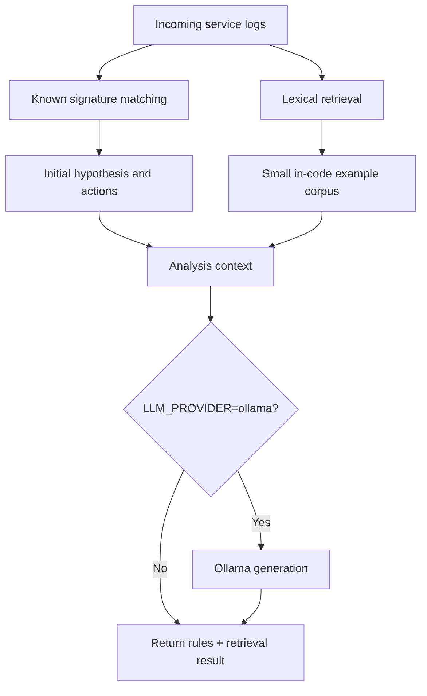

# AI Analysis and Retrieval

## Current pipeline

The current AI service combines deterministic log-signature analysis, lightweight lexical retrieval, and optional Ollama enrichment.



## Deterministic signatures

The current rules include patterns associated with:

- Database connection-pool exhaustion.
- Memory exhaustion.
- Connection refused or reset.
- Timeouts.
- Null-pointer exceptions.
- HTTP 500 responses.

A match produces a root-cause hypothesis, investigation recommendations, evidence text, and a qualitative confidence label. If no known signature matches, the service returns an insufficient-evidence response with general diagnostic steps.

The confidence label is a heuristic classification, not a statistically calibrated probability.

## Demonstration retrieval

`ai-service/app/rag.py` contains a small static incident corpus. It tokenizes log text and ranks examples using lexical Jaccard overlap.

This approach is intentionally lightweight and does not download an embedding model. It should be described as lexical demonstration retrieval rather than semantic vector search.

## pgvector status

The database initialization creates a `vector(384)` column on `historical_incidents`. The current application does not yet:

1. Generate 384-dimensional embeddings.
2. Ingest historical incidents into that column.
3. Execute pgvector nearest-neighbor queries.
4. Use retrieved database records in the analysis response.

A future implementation can add an embedding model, an ingestion pipeline, similarity search, index selection, and retrieval evaluation. Keep the embedding model dimension aligned with the database column.

## Optional Ollama

Default configuration:

```dotenv
LLM_PROVIDER=none
```

To enable Ollama, configure:

```dotenv
LLM_PROVIDER=ollama
OLLAMA_BASE_URL=http://host.docker.internal:11434
OLLAMA_MODEL=llama3.1:8b
```

The Ollama service/model must be available at the configured URL. On Linux, `host.docker.internal` may require explicit host-gateway configuration or a reachable host address.

The service falls back to the deterministic result if the Ollama request fails. Validate and constrain model output before using it in any downstream workflow.

## Evaluation recommendations

Before relying on AI analysis, build a labelled incident dataset and measure:

- Signature precision and recall.
- Retrieval relevance at K.
- Root-cause usefulness assessed by engineers.
- Recommendation safety and actionability.
- LLM schema validity and fallback rate.
- Latency and cost per analysis.

Treat logs and retrieved documents as untrusted input. Do not allow prompt content to trigger tools or operational actions.
